# 🗺️ Fluxo de dados e fronteiras de confiança

O diagrama de fluxo de dados (DFD — *Data Flow Diagram*) representa as requisições da API no TP2. O cliente é uma origem não confiável, mesmo quando executado no mesmo host. O processo FastAPI valida as entradas e a identidade; o SQLite mantém usuários e predições em um arquivo separado do processo. A classificação permanece um placeholder.

O [fonte editável em Mermaid](dfd.mmd) acompanha a [exportação vetorial SVG](dfd.svg). Ao alterar o fonte, atualize também a exportação exibida nesta página.

As setas de duas pontas representam consultas e seus resultados; na criação de uma predição, representam também gravação e confirmação. Os blocos são responsabilidades do código dentro de um único processo, sem serviços de autenticação ou inferência separados.

## 🔎 Fluxos conferidos no código

| Entrada | Processamento e dados | Resultado |
| --- | --- | --- |
| `POST /auth/token` | Limita cinco tentativas por IP em 60 segundos, valida o formulário Pydantic, consulta o usuário via SQLModel, verifica o hash PBKDF2 da senha e assina o JWT com HS256. | Token e tipo `bearer`, 401 para credenciais inválidas, 422 para campos desconhecidos ou inválidos e 429 ao exceder o limite. |
| `POST /predict` | `get_current_user` verifica assinatura, expiração e sujeito do JWT e consulta o usuário. Pydantic rejeita campos extras e exige texto entre 5 e 100 caracteres. A rota grava texto, `owner_id` da identidade validada, intenção fixa e confiança 0,0. | `id`, `intencao_prevista` e `confianca`; o texto e o proprietário não são expostos na resposta. |
| `GET /predictions/{prediction_id}` | Valida a identidade e consulta a predição filtrando simultaneamente o ID solicitado e o `owner_id` autenticado. | Registro próprio ou 404 para ID inexistente ou de outro usuário. Token ausente ou inválido recebe 401. |
| `GET /health` | Retorna valores fixos, sem consultar o banco ou verificar dependências. | Status e nome do serviço; não comprova disponibilidade do SQLite. |

Esses fluxos estão implementados em [autenticação](../../app/api/routes/auth.py), [segurança JWT](../../app/core/security.py), [predições](../../app/api/routes/predict.py) e [health](../../app/api/routes/health.py). A [entrada da aplicação](../../app/main.py) configura CORS e os headers HTTP. As respostas também podem apresentar erros de validação, como 422; a tabela destaca os resultados específicos de cada fluxo.

## ⚙️ Inicialização e limites da representação

Na inicialização, a aplicação verifica a chave secreta e cria as tabelas pela [camada de banco](../../app/db/database.py). Se as duas variáveis de bootstrap estiverem preenchidas e o usuário não existir, cria o usuário inicial com hash de senha. A configuração vem do ambiente, com carregamento opcional de `.env`; esses passos de inicialização não aparecem como requisições no diagrama.

O arquivo SQLite padrão fica em `data/processed/ecomshield.db`. O limite de autenticação é mantido em memória por processo. O texto recebido é armazenado para demonstração, sem executar instruções ou acionar ferramentas. O notebook e o dataset pertencem ao fluxo de análise offline e não são consultados pelas rotas. Não há modelo treinado nem chamada a serviço externo em runtime.

A execução local usa HTTP e o comando do README desabilita proxy headers com `--no-proxy-headers`, preservando o IP da conexão usado no rate limiting. TLS e controles de rede dependem da implantação; o header HSTS não cifra essa conexão local. CORS é uma política para navegadores e não substitui a autenticação. Consulte também as [ameaças e limitações](../security/stride.md) e o [mapa de controles OWASP](../security/owasp-api-top10.md).
