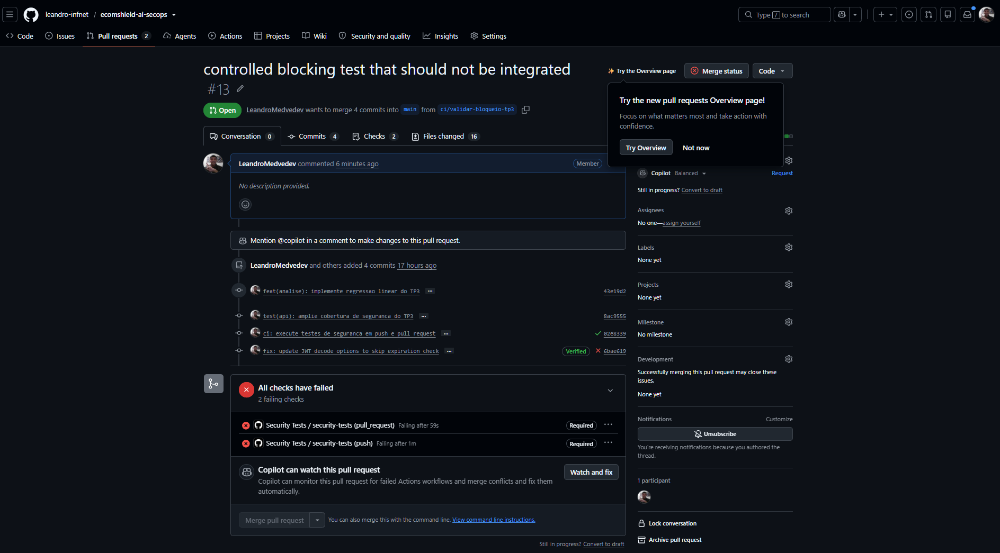
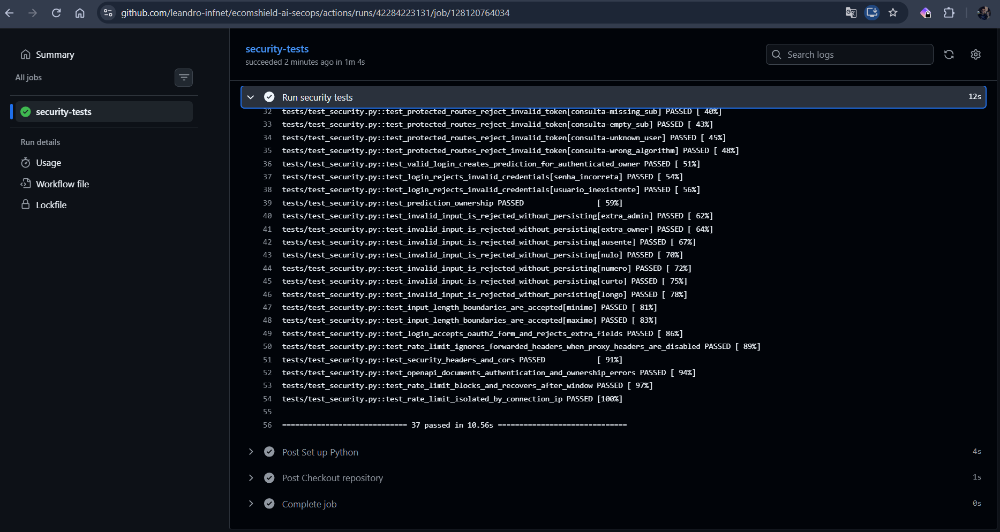
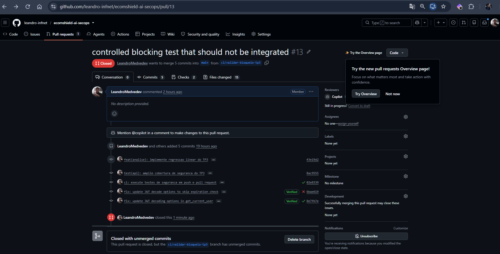

# 🔄 TP3 — Evidências da integração contínua

**Exercício 3 concluído nas evidências registradas:** o GitHub Actions executou os testes em push e pull request; uma regressão de segurança fez os checks obrigatórios falharem e bloqueou o merge para `main`. Após restaurar a validação, os 37 testes passaram novamente e o PR temporário foi fechado sem merge.

O [relatório técnico de CI](../security/tp3-ci.md) explica o workflow e seus limites. Este índice reúne os registros visuais fornecidos pelo aluno, os links de origem e a sequência do experimento.

## 1. Contexto e rastreabilidade

| Registro | Identificação |
| --- | --- |
| Workflow | [Security Tests](../../.github/workflows/security-tests.yml), job `security-tests` |
| PR principal do TP3 | [#12, feat/tp3 → main](https://github.com/leandro-infnet/ecomshield-ai-secops/pull/12) |
| PR do experimento | [#13, ci/validar-bloqueio-tp3 → main](https://github.com/leandro-infnet/ecomshield-ai-secops/pull/13), fechado sem merge |
| Regra de proteção | [Configuração de main](https://github.com/leandro-infnet/ecomshield-ai-secops/settings/branch_protection_rules/85936787), acesso sujeito às permissões do GitHub |
| Commit com regressão | `6bae619`, identificação abreviada visível nas capturas |
| Commit com restauração | `8e7fb7e`, identificação abreviada visível nas capturas |
| Registro inicial aprovado | [Job 127921045081](https://github.com/leandro-infnet/ecomshield-ai-secops/actions/runs/42226445359/job/127921045081), anterior ao experimento |

A regressão foi introduzida exclusivamente na branch temporária: `verify_exp=False` desativou a verificação de expiração em `jwt.decode`. Os dois testes de token expirado detectaram a alteração. A restauração removeu essa opção, preservando os testes e a configuração do workflow.

## 2. Proteção de main

As capturas mostram a regra aplicada à `main`, PR obrigatório sem aprovação de outro revisor, check `security-tests` obrigatório com origem GitHub Actions, exigência de branch atualizada e bloqueio de bypass inclusive para administradores. Force push e exclusão da branch permanecem desabilitados.

| Captura | Evidência |
| --- | --- |
| [01 — Branch e PR obrigatório](imgs/img-01.png) | Padrão `main`, aplicação a uma branch e aprovação de revisor desmarcada |
| [02 — Checks e bypass](imgs/img-02.png) | Check obrigatório, origem GitHub Actions, atualização da branch e bloqueio de bypass |
| [03 — Restrições adicionais](imgs/img-03.png) | Conta autorizada, restrição de criação, force push e exclusão desabilitados |

O formulário de edição, isoladamente, não comprova enforcement. A [captura 04](imgs/img-04.png) complementa as configurações com o bloqueio efetivo do PR por checks reprovados identificados como **Required**.

## 3. Falha detectada e merge bloqueado

| Evento | Execução | Job | Resultado do pytest |
| --- | --- | --- | --- |
| push | [42258874291](https://github.com/leandro-infnet/ecomshield-ai-secops/actions/runs/42258874291) | [128033247726](https://github.com/leandro-infnet/ecomshield-ai-secops/actions/runs/42258874291/job/128033247726) | **2 failed, 35 passed in 10.83s**, código 1 |
| pull_request | [42259590728](https://github.com/leandro-infnet/ecomshield-ai-secops/actions/runs/42259590728) | [128035713308](https://github.com/leandro-infnet/ecomshield-ai-secops/actions/runs/42259590728/job/128035713308) | **2 failed, 35 passed in 10.72s**, código 1 |

Falharam `test_protected_routes_reject_invalid_token[predict-expired]` e `test_protected_routes_reject_invalid_token[consulta-expired]`. Sem validar expiração, `/predict` respondeu 200 e a consulta respondeu 404, em vez dos 401 esperados. O 404 representa a busca por um registro inexistente após o token expirado ter sido aceito; não demonstra autenticação correta.

| Captura | Evidência |
| --- | --- |
| [04 — PR bloqueado](imgs/img-04.png) | PR #13 aberto, checks de push e PR reprovados como Required e botão de merge desabilitado |
| [05 — Falha no push](imgs/img-05.png) | Execução associada à branch temporária e ao commit `6bae619`, código 1 |
| [06 — Testes reprovados no push](imgs/img-06.png) | Dois testes de expiração falharam; outros 35 passaram |
| [07 — Falha no pull request](imgs/img-07.png) | Workflow disparado pela abertura do PR #13, código 1 |
| [08 — Testes reprovados no PR](imgs/img-08.png) | Os mesmos dois casos detectaram a regressão |

## 4. Recuperação após restaurar a validação

| Evento | Execução | Job | Resultado do pytest |
| --- | --- | --- | --- |
| push | [42284213012](https://github.com/leandro-infnet/ecomshield-ai-secops/actions/runs/42284213012) | [128120729491](https://github.com/leandro-infnet/ecomshield-ai-secops/actions/runs/42284213012/job/128120729491) | **37 passed in 11.76s** |
| pull_request | [42284223131](https://github.com/leandro-infnet/ecomshield-ai-secops/actions/runs/42284223131) | [128120764034](https://github.com/leandro-infnet/ecomshield-ai-secops/actions/runs/42284223131/job/128120764034) | **37 passed in 10.56s** |

| Captura | Evidência |
| --- | --- |
| [09 — Checks recuperados](imgs/img-09.png) | Commit de restauração `8e7fb7e`, checks obrigatórios aprovados e merge novamente disponível |
| [10 — Testes aprovados no push](imgs/img-10.png) | 37 testes passaram após a restauração |
| [11 — Execução de push aprovada](imgs/img-11.png) | Resultado Success na branch temporária, commit `8e7fb7e` |
| [12 — Execução do PR aprovada](imgs/img-12.png) | Resultado Success após sincronização do PR #13 |
| [13 — Testes aprovados no PR](imgs/img-13.png) | 37 testes passaram na execução de pull_request |

## 5. Encerramento sem integração

A [captura 14](imgs/img-14.png) mostra o PR #13 como **Closed**, o evento de fechamento e a mensagem **Closed with unmerged commits**. O experimento foi encerrado sem incorporar seus commits à `main`.

## 6. Alcance e origem das evidências

As imagens foram capturadas pelo aluno e inspecionadas localmente na consolidação documental. As URLs dos registros de falha e recuperação correspondem às barras de endereço visíveis nas capturas. A ferramenta de navegação não conseguiu abrir diretamente o PR e a execução consultados nesta consolidação; não foi realizada consulta autenticada do estado remoto atual.

As evidências demonstram execução automática, detecção da regressão exercitada, bloqueio de merge e recuperação naquele histórico. Não demonstram deployment, auditoria ZAP, proteção contra toda alteração futura do workflow ou ausência de vulnerabilidades na API. O aviso informativo sobre migração de `ubuntu-latest` não foi a causa da falha: os logs mostram as assertivas dos testes e o código de saída 1.

As capturas usadas nesta documentação estão exclusivamente em `imgs/`; nenhum documento depende da antiga pasta `images/`. Os arquivos originais foram preservados, sem edição de pixels ou alteração de nomes.

## Fontes e uso de IA

- [Workflow versionado](../../.github/workflows/security-tests.yml), [suíte de segurança](../../tests/test_security.py) e registros remotos vinculados neste índice.
- [GitHub Docs: checks obrigatórios e proteção de branches](https://docs.github.com/en/repositories/configuring-branches-and-merges-in-your-repository/managing-protected-branches/about-protected-branches).
- Codex (OpenAI) auxiliou na revisão das capturas e na consolidação da documentação. As operações no GitHub e as capturas foram realizadas pelo aluno; os resultados remotos não são apresentados como novas execuções locais do agente.
