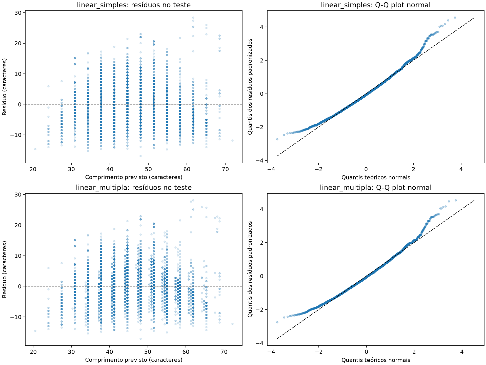

# 📊 TP3 — Regressão do comprimento das mensagens

O [notebook executado](../../notebooks/02_regressao_ecomshield.ipynb) atende ao exercício 1: pré-processamento, regressão linear simples e múltipla, R², RMSE, residual plots, Q-Q plots e limitações. O alvo é o comprimento da mensagem em caracteres. A classificação de intenções será planejada nos demais exercícios; a API mantém seu placeholder.

## Dados e escolhas

Usamos o mesmo CSV da [EDA do TP2](tp2.md): 26.872 mensagens, cinco colunas, nenhum ausente, nenhuma linha inteira duplicada e 2.237 repetições de `instruction`. Não há textos vazios nem instruções com rótulos conflitantes. O bruto foi preservado; repetições e extremos de comprimento não foram removidos. O hash SHA-256 do arquivo analisado é:

```text
6f81102b0100b97b8468eb04368033a23206bf1fde9d53500d5806ec1001a434
```

A regressão simples usa contagem de palavras; a múltipla acrescenta contagem dos sinais `! ? . , ; :`, seguindo a EDA. Não usamos rótulos de intenção ou respostas como atributos. Estimar comprimento é um exercício didático: ele pode ser calculado diretamente, e os atributos medem partes do mesmo texto. Uma boa associação não comprova compreensão de intenção.

A divisão por `GroupShuffleSplit`, semente 42, reserva 20% dos textos distintos para teste: 21.466 linhas de treino e 5.406 de teste, com 19.708 e 4.927 grupos respectivamente. **Zero textos exatos compartilhados** entre treino e teste, verificado por assertiva no notebook. Textos com diferenças de caixa, espaços, templates e paráfrases ainda podem atravessar a divisão.

Cada regressão usa `ColumnTransformer` → `StandardScaler` → `LinearRegression`. A seleção de atributos é explícita; média e escala são ajustadas apenas no treino. O baseline `DummyRegressor` sempre devolve a média de caracteres do treino. Não houve busca de parâmetros ou seleção iterativa pelo teste.

## Resultados no teste

| Modelo | R² | RMSE (caracteres) |
| --- | ---: | ---: |
| Média do treino | −0,000160 | 10,754452 |
| Regressão simples | 0,665791 | 6,216737 |
| Regressão múltipla | 0,666675 | 6,208517 |

R² compara o erro quadrático com a variabilidade em torno da média do teste. O múltiplo explica aproximadamente 66,67% dessa variabilidade nesta divisão; isso não é acurácia de intenção. RMSE é a raiz do erro quadrático médio, na unidade do alvo, e penaliza mais erros grandes. Os 6,209 caracteres não constituem limite máximo de erro por mensagem.

O baseline apresenta R² ligeiramente negativo porque prevê a média do treino, que difere da média do teste. A pontuação reduz o RMSE em apenas 0,008 caractere em relação ao simples. A melhora medida não demonstra utilidade prática nem significância estatística. As métricas foram conferidas também pelas fórmulas no notebook, independentemente das funções do scikit-learn.

## Diagnóstico dos resíduos



O resíduo é observado menos previsto. No múltiplo, a média global é 0,024 caractere, mas as médias em quatro faixas de previsão são −0,556, +1,635, +1,403 e −1,640: há subestimação no centro e superestimação em parte da faixa superior. A média global próxima de zero esconde viés local. As colunas de pontos decorrem dos atributos discretos.

Os desvios por faixa variam de 5,745 a 6,275 caracteres. A dispersão não é idêntica; o diagnóstico visual e descritivo não comprova variância constante. Nos Q-Q plots, o centro acompanha aproximadamente a normal, mas as caudas se afastam da diagonal, principalmente a direita. A assimetria positiva do múltiplo é 0,439. Não assumimos normalidade nem calculamos intervalos ou testes clássicos dos coeficientes.

## Limitações e próximos passos

As relações entre palavras, pontuação e comprimento são estruturais, sem interpretação causal. O coeficiente condicional negativo de pontuação não significa que acrescentar um sinal encurte um texto. Templates semelhantes podem tornar a avaliação otimista apesar do agrupamento de textos idênticos; uma divisão única também não mede a variabilidade entre partições. O corpus em inglês não demonstra desempenho em português ou produção.

A regressão produz valores contínuos. Intenções são categorias nominais, sem ordem ou distância numérica: codificá-las com inteiros e arredondar previsões imporia uma geometria arbitrária e poderia produzir valores sem classe correspondente. Mensagens de mesmo comprimento podem ter intenções distintas. A próxima etapa do TP3 é formalizar as classes e planejar aprendizado supervisionado com features textuais, controle de vazamento e métricas por classe; o treinamento do classificador pertence à fase preditiva.

## Reprodução e evidências

A execução foi feita em kernel novo com Python 3.14.4 e scikit-learn 1.9.1. As versões estão fixadas em [requirements.txt](../../requirements.txt), incluindo as novas dependências transitivas. O [JSON de resultados](tp3-regressao-resultados.json) registra ambiente, hash do CSV, qualidade, divisão, métricas e resumo dos resíduos, sem mensagens individuais. A figura está exportada também como PNG independente.

Depois de instalar as dependências e colocar o CSV em `data/raw/bitext_intent.csv`, abra o notebook com o kernel do `venv/`, reinicie o kernel e execute todas as células. Para execução sem interface, da raiz:

```bash
PATH="$PWD/venv/bin:$PATH" venv/bin/python -c 'from nbclient.cli import main; main()' --kernel_name=python3 --timeout=120 --inplace notebooks/02_regressao_ecomshield.ipynb
```

O comando chama o executor pelo Python explícito do ambiente e prioriza esse ambiente no kernel `python3` padrão. Isso evita scripts de entrada com caminhos antigos se o ambiente virtual tiver sido copiado de outra pasta, como observado neste workspace. Confira o executável caso seu kernelspec use outro caminho absoluto. A execução precisa de permissão para os sockets locais do Jupyter. Preserve uma cópia do notebook antes de sobrescrever outputs; cada execução atualiza também o JSON e a figura. Nenhum teste da API ou scan ZAP é evidência desta etapa.

## Fontes e uso de IA

- [Bitext: dataset de atendimento](https://huggingface.co/datasets/bitext/Bitext-customer-support-llm-chatbot-training-dataset).
- [scikit-learn: LinearRegression](https://scikit-learn.org/stable/modules/generated/sklearn.linear_model.LinearRegression.html) e [GroupShuffleSplit](https://scikit-learn.org/stable/modules/generated/sklearn.model_selection.GroupShuffleSplit.html).
- [SciPy: distribuição normal e quantis](https://docs.scipy.org/doc/scipy/reference/generated/scipy.stats.norm.html).
- Codex (OpenAI, gpt-6.1-sol) auxiliou na implementação, execução, inspeção dos gráficos e redação. Os resultados foram calculados localmente e devem ser revisados pelo aluno.

Continue pela [visão geral do projeto](../../README.md) e pelo [glossário](../glossario.md).
